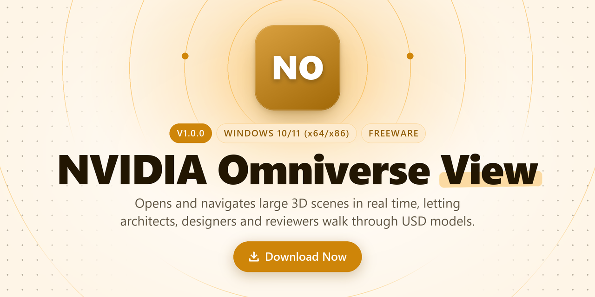

<h1 align="center">NVIDIA Omniverse View - Real-Time USD Scene Review on Windows 10/11</h1>

<p align="center"><i>NVIDIA Omniverse View opens and navigates large USD scenes in real time for architectural and design review workflows. This page documents requirements, configuration paths, scene and render mode comparisons, shortcuts, CLI flags, and troubleshooting steps for Windows 10/11 workstations.</i></p>

<p align="center">&nbsp;&nbsp;&nbsp;&nbsp;&nbsp;&nbsp;&nbsp;&nbsp;</p>

<p align="center"></p>

<p align="center">
  <a href="https://noor5239.github.io/nvidia-omniverse-view/">
    <picture>
      <source media="(prefers-color-scheme: dark)" srcset="./assets/Click-dark.svg">
      
    </picture>
  </a>
</p>

<p align="center"><a href="#overview">Overview</a> &nbsp;|&nbsp; <a href="#requirements">Requirements</a> &nbsp;|&nbsp; <a href="#key-features">Key Features</a> &nbsp;|&nbsp; <a href="#configuration">Configuration</a> &nbsp;|&nbsp; <a href="#render-mode-comparison">Render Mode Comparison</a> &nbsp;|&nbsp; <a href="#keyboard-shortcuts">Keyboard Shortcuts</a> &nbsp;|&nbsp; <a href="#command-line-options">Command-Line Options</a> &nbsp;|&nbsp; <a href="#troubleshooting">Troubleshooting</a> &nbsp;|&nbsp; <a href="#faq">FAQ</a> &nbsp;|&nbsp; <a href="#notes">Notes</a></p>

## Overview

Omniverse View is a lightweight viewer application built on the Omniverse Kit runtime. It connects to a Nucleus server or a local USD stage and renders the scene interactively without requiring the authoring applications that produced it.

### What It Does

Loads OpenUSD stages of arbitrary size and streams them to a real-time viewport with path tracing, rasterization, or hybrid rendering. Reviewers can move through the scene, isolate layers, and toggle variant sets without editing the source files.

### Who It Is For

Architects, design reviewers, and project stakeholders who need to inspect USD deliverables without a full DCC install. It is also used by BIM coordinators to validate exported geometry and by presentation teams to run walkthroughs on a workstation or connected display.

### What Ships in the Build

The installer places the Kit-based viewer executable, the Omniverse launcher integration stub, the Nucleus connector libraries, and a set of default renderer and stage settings under the user profile. No authoring tools are bundled; View only consumes USD content.

## Requirements

| Spec | Minimum | Recommended |
|------|---------|-------------|
| OS | Windows 10 21H2 (64-bit) | Windows 11 23H2 or later |
| CPU | 4-core Intel Core i5 or AMD Ryzen 5 | 8-core Intel Core i7 or AMD Ryzen 7 |
| RAM | 16 GB | 32 GB or more for stages over 2 GB |
| GPU / display | NVIDIA RTX 2070, 8 GB VRAM, driver 535+ | NVIDIA RTX 4080 or RTX A5000, 16 GB VRAM |
| Storage | 10 GB free for app and cache | 50 GB NVMe free for local stage cache |
| Nucleus access | Local file stages only | Nucleus server with 1 Gbps or faster link |

## Key Features

* **Real-time USD navigation** , walks camera through stages with sub-frame latency on supported RTX GPUs.
* **Path-traced viewport** , renders physically based lighting and materials without a separate bake step.
* **Variant set switching** , swaps design options defined in USD variants from a side panel.
* **Layer visibility control** , toggles individual USD layers and prim hierarchies per session.
* **Nucleus streaming** , opens stages hosted on a Nucleus server without full local download.
* **Snapshot capture** , writes viewport frames to PNG or EXR for review documentation.
* **Collaboration session join** , connects to live Omniverse sessions for synchronized camera review.
* **Stage statistics overlay** , reports triangle count, draw calls, and frame time in real time.

## Configuration

| Path | Purpose |
|------|---------|
| `%LOCALAPPDATA%\NVIDIA\Omniverse\View\logs` | Session logs and Kit runtime output |
| `%LOCALAPPDATA%\NVIDIA\Omniverse\View\cache` | Local USD stage and shader cache |
| `%APPDATA%\NVIDIA\Omniverse\View\user.config.json` | Per-user renderer and viewport settings |
| `%PROGRAMDATA%\NVIDIA Corporation\Omniverse\Nucleus` | Shared Nucleus connection and trust config |
| `%LOCALAPPDATA%\NVIDIA\Omniverse\View\extensions` | User-installed Kit extensions |
| `%APPDATA%\NVIDIA\Omniverse\View\recent.json` | Recently opened stage list |

| Setting | Default | Notes |
|---------|---------|-------|
| Renderer mode | RTX Real-Time | Switch to Path Tracing or Raster in viewport settings |
| Update channel | Production | Options: Production, Beta, Early Access |
| Log level | Info | Raise to Debug for support bundles |
| Telemetry | Enabled | Disable under Privacy in app settings |
| Auto-reload stage | Off | Reloads stage on disk change when enabled |
| Camera speed | 1.0x | Adjustable per session; persisted to user.config.json |
| GPU selection | Auto | Pin to a specific RTX device on multi-GPU hosts |

## Render Mode Comparison

| Mode | Typical frame time (RTX 4080, 5M tris) | VRAM use | Hardware requirement | When to pick |
|------|----------------------------------------|----------|----------------------|--------------|
| RTX Real-Time | 8 to 16 ms | Moderate | RTX GPU, driver 535+ | Interactive walkthroughs and live review |
| Path Tracing | 60 to 200 ms | High | RTX GPU, 16 GB VRAM preferred | Final look validation and still captures |
| Raster | 4 to 10 ms | Low | Any supported RTX or GTX-class GPU | Large scenes on lower-VRAM systems |
| Hybrid (RTX + raster) | 12 to 30 ms | Moderate | RTX GPU | Balanced quality and throughput |

## Keyboard Shortcuts

| Action | Shortcut |
|--------|----------|
| Toggle fly / orbit camera | `F` |
| Frame selected prim | `F` (with selection) |
| Toggle layer visibility panel | `L` |
| Open stage browser | `Ctrl + O` |
| Reload current stage | `Ctrl + R` |
| Capture viewport snapshot | `Ctrl + Shift + S` |
| Toggle statistics overlay | `Ctrl + Shift + H` |
| Switch variant set | `V` |
| Reset camera to home view | `Home` |
| Open settings | `Ctrl + ,` |

## Command-Line Options

| Flag | Argument | Purpose |
|------|----------|---------|
| `--stage` | path or URL | Opens a local USD file or Nucleus stage on launch |
| `--renderer` | `rtx`, `path`, `raster` | Sets the active renderer mode |
| `--nucleus` | URL | Specifies the Nucleus server for remote stages |
| `--log-level` | `info`, `debug`, `warn` | Overrides the configured log verbosity |
| `--no-telemetry` | none | Disables telemetry for the session |
| `--fullscreen` | none | Starts in fullscreen presentation mode |
| `--gpu` | device index | Pins rendering to a specific GPU |
| `--headless-capture` | output path | Renders a single frame to file and exits |

```bash
omniverse-view.exe --stage "nucleus://projects/tower_a/scene.usd" --renderer rtx --log-level debug
```

| Exit Code | Meaning |
|-----------|---------|
| 0 | Clean exit |
| 1 | Stage failed to open |
| 2 | Renderer or GPU initialization failed |
| 3 | Nucleus connection refused |
| 4 | Invalid CLI argument |

## Troubleshooting

### Viewport shows black after opening a stage

Usually a renderer or GPU initialization failure, often after a driver update.

1. Check `%LOCALAPPDATA%\NVIDIA\Omniverse\View\logs` for renderer errors.
2. Confirm the NVIDIA driver is 535 or newer via `nvidia-smi`.
3. Relaunch with `--renderer raster` to isolate RTX path issues.
4. If raster works, reinstall the RTX driver using a clean install.

### Nucleus stages fail to load

Connection or trust issues between View and the Nucleus server.

1. Verify the Nucleus URL resolves with `ping` or a browser check.
2. Confirm your account has read access to the target project.
3. Clear `%LOCALAPPDATA%\NVIDIA\Omniverse\View\cache` and retry.
4. Re-add the server under Omniverse settings if trust prompts were declined.

### Stage loads slowly or stutters during navigation

Often caused by insufficient VRAM or an oversized local cache.

1. Check VRAM use in the statistics overlay (`Ctrl + Shift + H`).
2. Lower texture resolution in viewport settings.
3. Switch to the raster renderer for stages over 10M triangles.
4. Move the stage cache to an NVMe drive.

### Snapshot capture produces empty files

Typically a permissions or path issue on the output folder.

1. Confirm the target folder is writable by your account.
2. Avoid network shares for capture output.
3. Retry with `--headless-capture` to bypass the UI path.
4. Check the log for file write errors at the specified path.

## FAQ

### Can Omniverse View open stages without a Nucleus server?

Yes. Local USD files open directly via `Ctrl + O` or the `--stage` flag. Nucleus is only required for shared or streamed stages and for collaboration sessions.

### Does View need the full Omniverse Launcher installed?

View can run standalone from its own installer, but Launcher integration simplifies updates and Nucleus server registration. Standalone installs require manual config edits under `%APPDATA%` for server entries.

### How does View differ from Omniverse Create for review work?

View is read-only and optimized for navigation and presentation, while Create includes authoring, scene assembly, and simulation tools. Reviewers who only inspect USD stages should use View to avoid the heavier install and licensing footprint.

## Notes

NVIDIA, Omniverse, RTX, and Nucleus are trademarks of NVIDIA Corporation. Windows is a trademark of Microsoft Corporation. Feature availability and renderer behavior depend on GPU model, driver version, and Omniverse release channel.